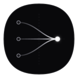

<p align="center">
  
</p>

# Converge

[](https://github.com/Clearxheaded/converge/actions/workflows/ci.yml)
[](https://golang.org)
[](LICENSE)

Converge is a lightweight, local-first distributed synchronization engine built in Go. It enables independent devices to modify data offline and converge deterministically to bit-for-bit identical state whenever connectivity is restored, without centralized coordinators or data loss.

---

## System Directive & Consistency Model

Converge satisfies **Strong Eventual Consistency (SEC)**. Any two replicas that have received the same set of updates reach identical state, regardless of message delivery order, network latency, or transient partitions.

State reconciliation is modeled as a state-based conflict-free replicated data type (CvRDT) forming a bounded join semi-lattice $(\mathcal{S}, \sqcup, \le)$:

1. **Commutativity:**
   $$A \sqcup B = B \sqcup A$$
   Packet delivery order does not affect the reconciled state.

2. **Associativity:**
   $$(A \sqcup B) \sqcup C = A \sqcup (B \sqcup C)$$
   Batching and intermediate routing hops do not alter the convergence outcome.

3. **Idempotence:**
   $$A \sqcup A = A$$
   Duplicate packet delivery across flapping links is a safe no-op.

### Deterministic Conflict Resolution (Total Order)

When concurrent writes occur across partitioned nodes, conflict resolution is governed by a strict total ordering function over records:

$$(ts_{\text{wall}}, ts_{\text{counter}}) \succ \text{replicaID} \succ \text{deleted} \succ \text{value} \succ \text{key}$$

- **Timestamp Precedence:** Higher Hybrid Logical Clock (HLC) physical wall time wins. If tied, higher logical counter wins.
- **Replica Tie-Breaking:** If HLC timestamps tie exactly, lexicographically larger `replica_id` wins.
- **Deletion Bias:** If timestamps and replica IDs tie, `deleted = true` (tombstone) defeats `deleted = false`.
- **Value & Key Tie-Breaking:** Deterministic byte-order comparison ensures identical convergence across all nodes.

---

## Distributed Systems Invariants

The Converge engine enforces the following invariants across storage, concurrency, and network transport:

| Invariant | Mathematical / Behavioral Guarantee | Enforcement Mechanism |
| :--- | :--- | :--- |
| **Clock Monotonicity** | Local timestamps are strictly monotonic ($ts_{i+1} > ts_i$). Logical counter increments if physical clock stalls or jumps backwards. | `internal/hlc` |
| **Lamport Causality** | If event $A \to B$ (A causally precedes B), then $ts(A) < ts(B)$ across all nodes, even under clock skew. | `internal/hlc` (HLC Receive Rule) |
| **Crash Recovery Safety** | On restart, HLC is primed with $\max(clock_{\text{persisted}}, \max(record_{\text{disk}}))$. Post-restart timestamps are strictly greater than all pre-crash timestamps. | `internal/storage` (`Seed`) |
| **Transactional Atomicity** | A record is never committed to SQLite without its corresponding HLC clock state in the same atomic transaction. In-memory CRDT updates only on commit. | `internal/storage` (SQLite WAL) |
| **Anti-Resurrection** | Deletions persist as durable tombstones. Stale writes arriving across network partitions cannot overwrite newer tombstones. | `internal/crdt`, `internal/storage` |
| **Stable Watermark GC** | Tombstones are purged only when a vector clock proves that all required cluster replicas have acknowledged state past the tombstone timestamp. | `internal/hlc`, `internal/storage` (`Compact`) |
| **Transitive Convergence** | Updates propagate across arbitrary graph topologies (line, star, mesh). Nodes forward remote updates to non-origin peers while terminating echo cycles. | `internal/sync` (`BroadcastExcept`) |
| **Partition Tolerance** | Replicas accept local writes during total network isolation. Reconnection triggers incremental watermark sync exchanging only delta mutations. | `internal/sync`, `internal/simulation` |

---

## Architecture

Converge implements a clean separation between in-memory CRDT structures, durable SQLite WAL persistence, and WebSocket replication transport:

```
+-------------------------------------------------------------------------+
|                           CONVERGE REPLICA                              |
|                                                                         |
|   +-----------------------------------------------------------------+   |
|   |                       Application Layer                         |   |
|   |          CLI Interactive REPL  /  Automated Cluster Demo        |   |
|   +--------------------------------+--------------------------------+   |
|                                    |                                    |
|                                    v                                    |
|   +-----------------------------------------------------------------+   |
|   |                    Storage Engine (SQLite WAL)                  |   |
|   |                                                                 |   |
|   |   +--------------------------+   +--------------------------+   |   |
|   |   | In-Memory LWW CRDT Map   |   | Hybrid Logical Clock     |   |   |
|   |   |  - Read latency < 60 ns  |   |  - Monotonic timestamps  |   |   |
|   |   |  - Concurrent RWMutex    |   |  - Causal receive rule   |   |   |
|   |   +------------+-------------+   +------------+-------------+   |   |
|   |                |                              |                 |   |
|   |                +--------------+---------------+                 |   |
|   |                               |                                 |   |
|   |                               v (writeMu Transaction)           |   |
|   |   +---------------------------------------------------------+   |   |
|   |   | SQLite WAL Database (PRAGMA synchronous = NORMAL)       |   |   |
|   |   |  - Table 'records'     (key, value, ts, replica, del)   |   |   |
|   |   |  - Table 'clock_state' (replica_id, wall_time, counter) |   |   |
|   |   +---------------------------+-----------------------------+   |   |
|   +-------------------------------|---------------------------------+   |
|                                   | (Commit Listener)                   |
|                                   v                                     |
|   +-----------------------------------------------------------------+   |
|   |                     WebSocket Sync Layer                        |   |
|   |                                                                 |   |
|   |   +--------------------+  +------------------+  +-----------+   |   |
|   |   | Handshake / Auth   |  | Watermark Vector |  | Gossip    |   |   |
|   |   |  - Loopback reject |  |  - Incremental   |  |  - Multi- |   |   |
|   |   |  - Version check   |  |    delta sync    |  |    hop    |   |   |
|   |   +--------------------+  +------------------+  +-----------+   |   |
|   +--------------------------------+--------------------------------+   |
|                                    |                                    |
+------------------------------------|------------------------------------+
                                     | WebSocket Wire Frames
                                     v (JSON / Compact Binary)
                         [ Network Mesh / Peers ]
```

### Replication Protocol State Machine

Each peer connection transitions through a deterministic state machine:

```
  [ DISCONNECTED ]
         |
         | Dial / Accept TCP
         v
  [ CONNECTING ]
         |
         | Upgrade to WebSocket
         v
  [ HANDSHAKING ] -----------------------+ (Version mismatch / self-connection)
         |                               |
         | Exchange HandshakePayload     v
         v                         [ TERMINATED ]
  [ CATCH_UP_SYNC ]
         |
         | Send SyncRequest(watermark)
         | Receive SyncResponse(records) -> SQLite Atomic Commit
         v
  [ STREAMING_ACTIVE ] <-----------------+
         |                               |
         | Push local UpdatePush frames  | Gossip remote wins
         | Ingest remote UpdatePush      | via BroadcastExcept
         | Ping / Pong heartbeats        |
         +-------------------------------+
         |
         | Socket error / Partition timeout
         v
  [ DISCONNECTED ] -> (Backoff Reconnect)
```

### Transitive Gossip Propagation

Replicas do not require full-mesh peering. Winning updates propagate transitively across arbitrary network topologies with automatic cycle suppression:

```
+----------+    Write     +----------+    Relay     +----------+
|  Node A  | -----------> |  Node B  | -----------> |  Node C  |
+----------+              +----------+              +----------+
     ^                                                    |
     |------------------ (Echo Terminated) ---------------+
```

---

## Empirical Benchmarks

Benchmarks measured on an Intel Core Ultra 9 275HX processor (Windows amd64, Go 1.27.3, CGO SQLite):

### 1. CRDT In-Memory Operations (`internal/crdt`)

| Operation | Latency | Throughput | Allocations |
| :--- | :--- | :--- | :--- |
| `Record Comparison` | 2.65 ns/op | ~377,000,000 ops/sec | 0 B/op, 0 allocs |
| `In-Memory Get` | 57.43 ns/op | ~17,400,000 ops/sec | 13 B/op, 1 alloc |
| `In-Memory Set` | 101.60 ns/op | ~9,840,000 ops/sec | 13 B/op, 1 alloc |
| `Merge 100 Disjoint Records` | 9.82 μs/op | ~10,180,000 records/sec | 23.9 KB/op, 10 allocs |
| `Merge 1,000 Disjoint Records` | 122.71 μs/op | ~8,150,000 records/sec | 392.7 KB/op, 21 allocs |
| `Merge 1,000 Conflicting Records` | 58.17 μs/op | ~17,190,000 records/sec | 0 B/op, 0 allocs |
| `Merge 1,000 Tombstone Records` | 64.09 μs/op | ~15,600,000 records/sec | 0 B/op, 0 allocs |

### 2. SQLite WAL Storage Engine (`internal/storage`)

| Operation | Latency | Throughput / Semantics |
| :--- | :--- | :--- |
| `Single Set (WAL Transaction)` | 33.82 μs/op | ~29,500 tx/sec (Durable record + HLC clock commit) |
| `In-Memory Get` | 50.53 ns/op | Lock-free query without SQLite disk contention |
| `Merge 100 Batch Records` | 167.57 μs/op | ~596,000 records/sec (Single atomic transaction) |
| `Merge 1,000 Batch Records` | 2.48 ms/op | ~402,000 records/sec (Single atomic transaction) |
| `Concurrent Set (8 Workers)` | 35.84 μs/op | Parallel mutations serialized via in-process write mutex |
| `RecordsSince (Watermark Query)` | 103.73 μs/op | Delta query across 1,000 SQLite records |

### 3. Protocol Wire Serialization (`internal/protocol`)

Comparing standard JSON against the zero-dependency Compact Binary codec:

| Payload Size | Format | Encode Latency | Decode Latency | Wire Size | Speedup |
| :--- | :--- | :--- | :--- | :--- | :--- |
| **100 Records** | JSON | 25.92 μs/op | 62.86 μs/op | 24.6 KB | Baseline |
| **100 Records** | **Binary** | **2.18 μs/op** | **5.07 μs/op** | **13.5 KB** | **11.8x encode, 12.4x decode (45% wire reduction)** |
| **1,000 Records** | JSON | 257.68 μs/op | 633.65 μs/op | 230.1 KB | Baseline |
| **1,000 Records** | **Binary** | **21.35 μs/op** | **53.81 μs/op** | **131.0 KB** | **12.1x encode, 11.8x decode (43% wire reduction)** |

### 4. WebSocket End-to-End Replication (`internal/sync`)

| Operation | Latency | Details |
| :--- | :--- | :--- |
| `Streaming Single Write` | 1.52 ms/op | Local write + WebSocket frame + remote SQLite commit |
| `Catch-Up Sync (500 records)` | 5.68 ms/op | Handshake, delta query, transmission, and SQLite batch commit |

Run the benchmarks locally:
```bash
go test -run='^$' -bench='.' ./internal/...
```

---

## Quick Start

### Prerequisites

- Go 1.22 or higher
- C toolchain (GCC / Clang) for SQLite CGO support

### 1. Run the Multi-Node Split-Brain Simulation

The CLI includes an automated 5-phase simulation that boots a 3-node cluster, applies concurrent conflicting writes during a simulated network split-brain partition, heals the partition, and verifies bit-for-bit convergence across SQLite databases:

```bash
# Automated run with paced terminal output
go run ./cmd/converge demo --auto

# Interactive step-by-step walkthrough (press Enter between phases)
go run ./cmd/converge demo
```

**Simulation Lifecycle:**
1. **Phase 1: Cluster Bootstrap:** Spins up Node A, Node B, and Node C with isolated SQLite databases and connects them in a mesh.
2. **Phase 2: Live Replication:** Writes to Node A; verifies real-time propagation across WebSockets to Nodes B and C.
3. **Phase 3: Network Partition & Split-Brain:** Partitions the network into isolated subsets `{A, B}` and `{C}`. Replicas accept concurrent conflicting writes while offline.
4. **Phase 4: Partition Healing & Convergence:** Restores network links. Nodes execute incremental watermark sync and converge to identical state via CRDT tie-breaking.
5. **Phase 5: SQLite Database Verification:** Directly inspects SQLite disk files (`records` and `clock_state` tables) to prove bit-for-bit consistency across all replicas.

### 2. Run Standalone Replicas Across Terminals

You can run independent live nodes in separate terminal windows that replicate over WebSockets in real time:

**Terminal 1 (Node A on port 8001):**
```bash
go run ./cmd/converge node --id node-a --listen :8001
```

**Terminal 2 (Node B on port 8002, peering with Node A):**
```bash
go run ./cmd/converge node --id node-b --listen :8002 --peers ws://localhost:8001
```

**Interactive REPL Commands:**
```text
> set user:101 {"name":"Alice","role":"admin"}
OK (HLC: 1793661642561:0)

> list
  user:101             = {"name":"Alice","role":"admin"}

> dump
  Key: user:101        | Val: {"name":"Alice"...} | HLC: 1793661642561:0 | Replica: node-a | ACTIVE

> delete user:101
OK (Tombstoned at HLC: 1793661642570:0, wasActive: true)

> peers
  - node-a       (Watermark: 1793661642570:0, Inbound: true)
```

---

## Repository Structure

```
converge/
├── cmd/converge/              CLI binary (split-brain demo and standalone REPL)
├── internal/
│   ├── crdt/                  LWW-Element-Set CRDT map and total order comparator
│   ├── hlc/                   Hybrid Logical Clock and vector clock watermarks
│   ├── storage/               SQLite WAL engine, crash recovery, and compaction
│   ├── protocol/              Typed message frames, binary codec, and validation
│   ├── sync/                  WebSocket transport, peer registry, and gossip
│   └── simulation/            Network proxy and partition fault-injection harness
├── assets/                    Geometric emblems and visual artifacts
├── docs/
│   ├── ARCHITECTURE.md        Mathematical foundations, invariants, and design trade-offs
│   └── PROGRESS.md            Engineering milestones and verification audit log
└── .github/workflows/
    └── ci.yml                 Automated CI (formatting, vet, tests, race detector, benchmarks)
```

---

## Verification & Testing Standards

Converge maintains strict testing standards across unit, property, concurrency, and network simulation suites:

```bash
# Run all unit and integration tests
go test ./...

# Run with Go race detector enabled
go test -race ./...

# Run static analysis
go vet ./...
```

All pull requests and commits are automatically verified in CI across Linux and Windows runners with CGO SQLite enabled.

---

## Design Trade-Offs

| Decision | Advantage | Explicit Trade-Off |
| :--- | :--- | :--- |
| **LWW Register Map** | Minimal memory footprint, deterministic conflict resolution. | Drops concurrent edits on the same key in favor of the highest total order timestamp. Not designed for collaborative text sequence editing. |
| **Durable Tombstones** | Prevents deleted keys from resurrecting when partitioned nodes sync. | Accumulates tombstone records on disk. Purging requires stable global vector clock compaction (`Compact`). |
| **Hybrid Logical Clock** | Captures causality while preserving physical wall-clock proximity. | Pathological forward physical clock jumps on a rogue replica can inflate timestamps until physical time catches up. |
| **Dual Wire Format (JSON & Binary)** | JSON offers transparent debugging and web compatibility; Binary delivers 12x throughput and 43% lower bandwidth. | Maintaining two codecs requires strict parity testing across protocol updates. |

---

## License

This project is licensed under the MIT License. See [LICENSE](LICENSE) for details.
